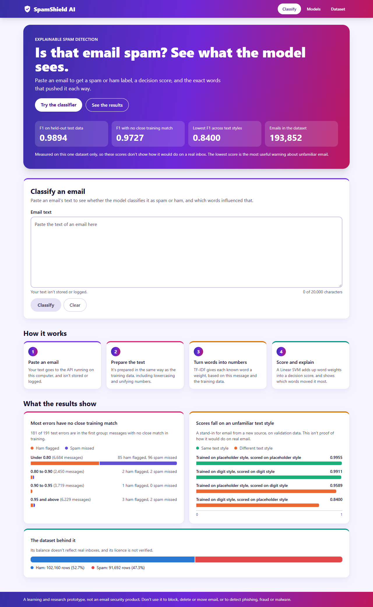

# SpamShield AI

An explainable email spam classifier, planned as an end-to-end machine learning application with a FastAPI backend and a React frontend. This is a learning and research prototype, not an email security product.

## Project status

**Milestone 5 of 6 is implemented and awaiting review.** A final model has been trained, saved and evaluated. A local API serves its predictions and explanations, and a local website lets you use them in a browser.

| Status | Work |
|---|---|
| Done | Python environment, dataset inspection, preprocessing, leakage-safe splits, feature experiments, model comparison, source-leakage experiment, final pipeline and evaluation, FastAPI backend, React and TypeScript website, tests |
| Planned | Final verification and documentation |



**Test result:** a Linear SVM reached F1 0.9894 for Spam on this dataset's held-out test split, or 0.9727 on messages with no close match in training. **These scores don't show real-world performance.** When trained on one number style and scored on another, as a stand-in for an unfamiliar source, F1 fell to 0.8400 and 21.3% of legitimate messages were flagged. See the [model card](docs/model-card.md).

The dataset's licence is not verified, so the raw data is not included or redistributed here. See the [dataset card](docs/dataset-card.md).

## Documentation

- [Product requirements](docs/PRD.md)
- [Project explanation](docs/PROJECT_EXPLANATION.md)
- [Model card](docs/model-card.md)
- [Architecture](docs/architecture.md)
- [Dataset card](docs/dataset-card.md)
- [Development log](docs/DEVELOPMENT_LOG.md)
- [Source-file explanations](docs/file-explanations/)

## Run the website

The saved model must already exist. If you've just cloned the repository, follow [Setup](#setup) and the training steps below first.

**Terminal 1, the API.** Run this from the repository root, with your Python environment active:

```powershell
cd backend
python -m uvicorn app.main:app --host 127.0.0.1 --port 8000
```

**Terminal 2, the website.** Run this from the repository root. You only need `npm install` the first time:

```powershell
cd frontend
npm install
npm run dev
```

Then open **http://localhost:5173** in your browser, and leave both terminals running. Press `Ctrl+C` in each to stop.

| Page | Address | What it shows |
|---|---|---|
| Classify | http://localhost:5173/ | The landing page: headline results, charts, and the classifier, which gives a label, a decision score and the words that influenced it |
| Models | http://localhost:5173/models | Saved model comparison, test results and the source-leakage experiment |
| Dataset | http://localhost:5173/dataset | Verified dataset statistics |

The decision score isn't a probability, so no confidence percentage is shown. The website sends text only to the local API, and doesn't store it.

## Setup

These commands are for Windows PowerShell, run from the repository root, and use Python 3.14. The website also needs Node 24.

1. Create and activate the virtual environment, then install the dependencies:

   ```powershell
   py -V:3.14 -m venv .venv
   .\.venv\Scripts\Activate.ps1
   python -m pip install -r backend\requirements.txt
   ```

   If PowerShell says running scripts is disabled, you can run this once and then activate again:

   ```powershell
   Set-ExecutionPolicy -Scope CurrentUser RemoteSigned
   ```

   This setting lets local scripts run for your Windows account, and requires downloaded scripts to be signed.

2. Get the dataset by following the [dataset instructions](backend/data/README.md). It is not included in this repository.

## Test

Run the backend tests from the repository root. They mostly use made-up data, so they don't need the dataset. A few use the real model when it's present, and skip otherwise:

```powershell
python -m pytest backend
```

Run the website's tests from the `frontend` folder:

```powershell
npm test                    # Unit tests, with the network replaced
npm run test:e2e            # Browser tests with the real API and model. Needs ports 8000 and 5173 free, and Edge
npm run test:e2e:api-down   # Browser tests with the API stopped
```

## Train and inspect

Inspect the dataset. This checks the file's hash and writes [`backend/reports/dataset_inspection.json`](backend/reports/dataset_inspection.json):

```powershell
python backend\training\inspect_dataset.py
```

Add `--show-examples` to print short text previews to the terminal. Previews are never saved to the report.

Run the data pipeline from the `backend` folder, in this order. The feature experiments take several minutes, and the largest needs about 3 GB of free memory:

```powershell
cd backend
python -m training.analyse_format
python -m training.prepare_data
python -m training.analyse_vocabulary
python -m training.feature_experiments --stage sample
python -m training.feature_experiments --stage scale
python -m training.feature_experiments --stage all_train
python -m training.feature_experiments --near-duplicates
```

Train and check the final model, also from `backend`. `train_final` replaces any saved model. The saved file isn't in Git, so a fresh copy of the repository needs these steps:

```powershell
python -m training.compare_models
python -m training.source_markers
python -m training.source_leakage
python -m training.train_final
python -m training.train_final --verify-reproducible
python -m training.train_final --verify-fingerprint
python -m training.final_evaluation --split validation
```

Load the saved model and classify a message, from `backend`:

```powershell
python -c "from app.ml.predict import load_pipeline; print(load_pipeline().predict(['Example message text']))"
```

The test split can be evaluated only once, so `--split test` refuses to run while its report exists. The [model card](docs/model-card.md#reproducibility) explains this.

## Use the API directly

The website uses this API, and you can also call it yourself. Start it as shown under [Run the website](#run-the-website). If the saved model doesn't exist, it still starts, and `/api/health` explains what to do.

| Address | Purpose |
|---|---|
| `http://127.0.0.1:8000/api/health` | Is the API up, and is the model loaded? |
| `http://127.0.0.1:8000/api/model-info` | Model details, measured results and limitations |
| `http://127.0.0.1:8000/api/results/models` | Saved model comparison, final evaluation and source-leakage results |
| `http://127.0.0.1:8000/api/results/dataset` | Verified aggregate dataset statistics |
| `http://127.0.0.1:8000/docs` | Interactive documentation, which also lets you try the classify endpoint. Its page loads scripts from the internet. |

To classify a message, run this in a second terminal:

```powershell
Invoke-RestMethod -Method Post -Uri http://127.0.0.1:8000/api/classify -ContentType application/json -Body '{"text": "You have won a free prize. Click here to claim."}' | ConvertTo-Json -Depth 5
```

The response gives a label, a score and the terms that influenced it. `confidence` is always `null`, because this model doesn't provide a meaningful probability. Text can be up to 20,000 characters, and it isn't stored or logged.

To compare API results with direct inference on all validation messages, run this from `backend`:

```powershell
python -m training.verify_api
```

## Repository layout

```text
spamshield-ai/
├── backend/
│   ├── app/                       The API, and preprocessing shared with training
│   ├── data/
│   │   ├── README.md              How to get the dataset
│   │   ├── processed/             Generated split file (not committed)
│   │   └── raw/                   Local dataset file (not committed)
│   ├── models/                    Saved model (not committed) and its metadata
│   ├── reports/                   Generated results
│   ├── tests/                     Automated tests
│   ├── training/                  Inspection, data preparation, experiments and training
│   ├── pytest.ini
│   └── requirements.txt
├── frontend/
│   ├── src/                       The React and TypeScript website, and its unit tests
│   ├── tests/e2e/                 Browser tests with the real backend
│   └── package.json
├── docs/                          Requirements, explanations, logs and screenshots
├── .gitignore
└── README.md
```

Other folders will be added when a milestone needs them.
